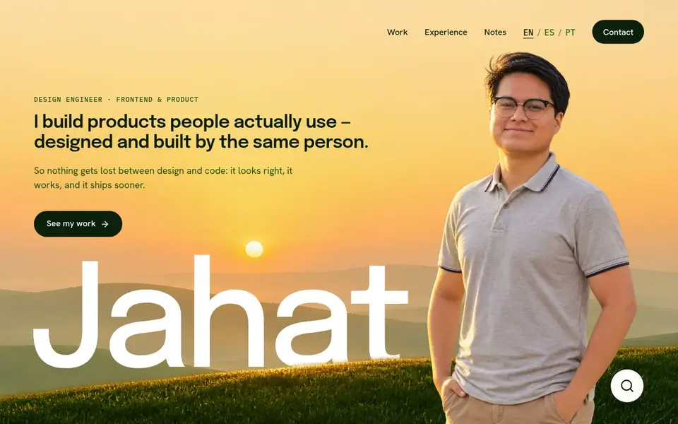
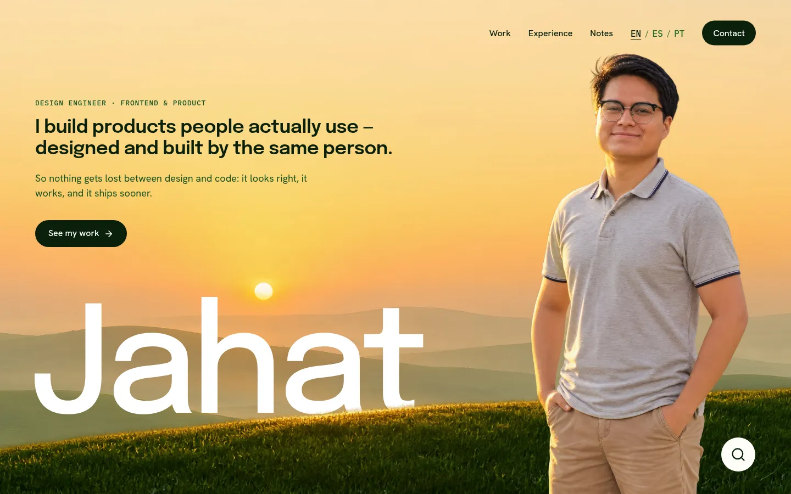
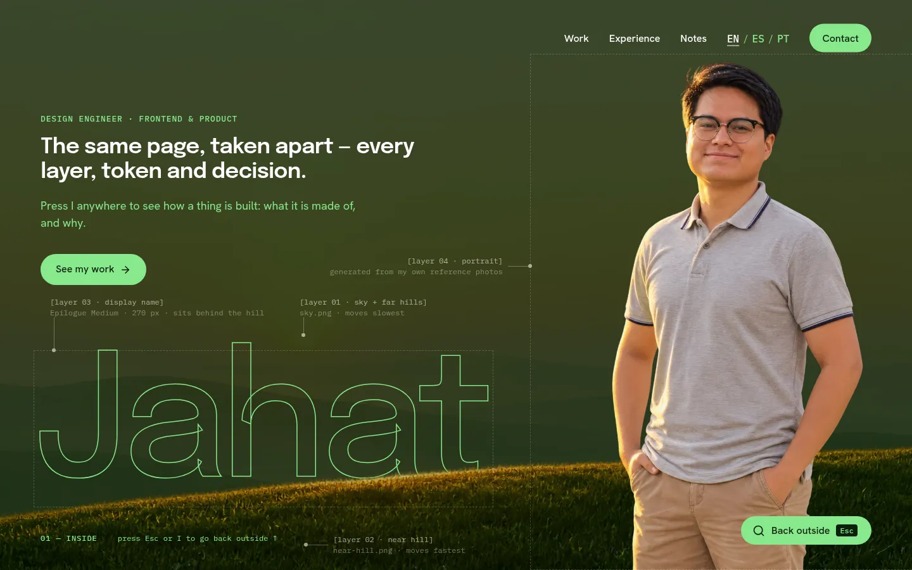
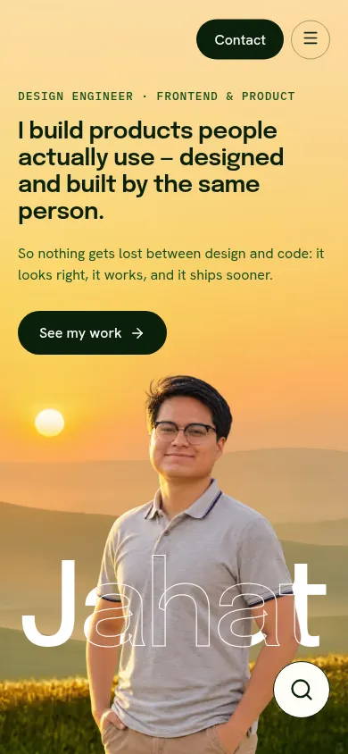
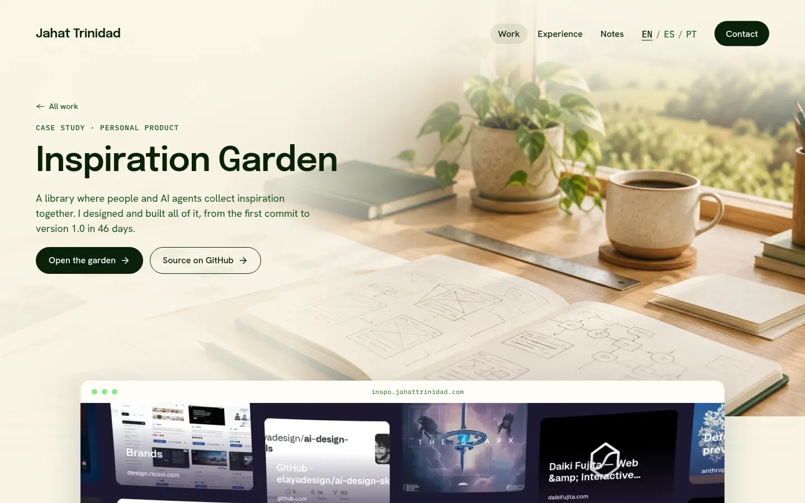
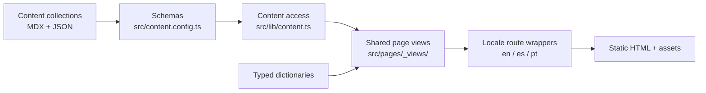

<div align="center">

# Jahat Trinidad

I build products people actually use — designed and built by the same person.


[Live site](https://jahattrinidad.com) · [Work](https://jahattrinidad.com/work/) · [CV](https://jahattrinidad.com/cv/jahat-trinidad-cv-en.pdf)

</div>



## What's inside

- **Two perspectives.** The lens switches between a welcoming Outside and a technical Inside, complete with annotated hero layers. Drag to preview on desktop, or press **I** to switch.
- **Three languages.** English, Spanish, and Brazilian Portuguese have localized routes and human translations. A first-visit redirect finds an available counterpart; `translate="no"` helps prevent browser translation from replacing the intended language.
- **A conversational contact form.** A scripted chat guides visitors through the details before they send a message.
- **Stories with substance.** Case studies combine the problem, decisions, and technical details in one view.
- **Made to be shared.** Notes and case studies get generated Open Graph images; the site also publishes an [RSS feed](https://jahattrinidad.com/rss.xml) and sitemap.
- **Motion with an exit.** Page transitions, section glow transitions, and scroll reveals add movement while respecting reduced-motion preferences.
- **A CV in each locale.** The site links to an English, Spanish, or Portuguese PDF for the selected language.

| Outside | Inside | Mobile |
| --- | --- | --- |
|  |  |  |



## By the numbers

**25 pages built** · **3 locales** · **50 tests** · **8 runtime dependencies**  
Measured from the local production build, Node test run, and `package.json`.

## Run locally

Requires Node.js **22.18.0 or newer** and npm.

```bash
npm install
npm run dev
```

Open the local URL printed by Astro. Before submitting a change, run:

```bash
npm run check
```

This runs the architecture boundary checker, Node tests, Astro's diagnostics, and a production build. `npm run build` builds separately; `npm run preview` serves that build locally. The static output is written to `dist/`. The Cloudflare configuration in `wrangler.jsonc` serves that directory as static assets, without an Astro adapter or Worker script.

## How it fits together



- **Content boundary.** `src/lib/content.ts` is the single place that calls Astro's collection and rendering APIs. `scripts/check-boundaries.mjs` checks this and keeps portable UI components independent of project-specific helpers. For example, a direct content import from a page fails with:

  ```text
  ✖ src/pages/example.ts:1
      rule  B1 — only src/lib/content.ts may import 'astro:content'
      stmt  import { getCollection } from 'astro:content'
      fix   call the exported functions from src/lib/content.ts instead of importing astro:content directly
  ```
- **Three locales.** English routes are unprefixed; Spanish and Brazilian Portuguese use `/es/` and `/pt/`. UI dictionaries are typed, and translated project entries are linked by `translationKey`. A first-visit redirect prefers an explicit language choice, then browser languages, and only redirects when a counterpart exists. Notes currently remain in English.
- **Motion with an exit.** GSAP drives scroll reveals and transitions, with Lenis for smooth scrolling. Motion components respect reduced-motion preferences. The lens itself controls the semantic colors through `color-scheme` and CSS `light-dark()` tokens.
- **Content and presentation.** Astro content collections validate MDX and JSON at build time. Shared page views are used by thin locale routes; interactive pieces use browser-side scripts rather than a UI framework.

## Project map

```text
src/
  components/       Sections, content components, and portable UI
  content/          Projects, posts, experience, and links
  content.config.ts Collection loaders and schemas
  layouts/          Shared page layouts
  lib/              Content access, translations, paths, and site logic
  pages/            Shared views and locale routes
  styles/           Tokens and global styles
scripts/            Architecture boundary checker
openspec/           Design and implementation decisions
wrangler.jsonc      Cloudflare static assets configuration
```

## Contributing

Read [CLAUDE.md](CLAUDE.md) for the project's detailed conventions. In particular, use the content access functions rather than importing Astro content APIs elsewhere; put UI copy in all three dictionaries; build internal links with the locale-aware path helpers; and use `astro/zod` for schemas. Keep `src/components/ui/` portable and run `npm run check` before handing off changes.

## Design notes

The visual direction was developed in Figma before implementation. The [visual design proposal](openspec/changes/portfolio-visual-design/proposal.md) and [design record](openspec/changes/portfolio-visual-design/design.md) document the Outside/Inside model, palette, typography, and decisions; the [implementation proposal](openspec/changes/portfolio-implementation/proposal.md) connects those decisions to the code.
