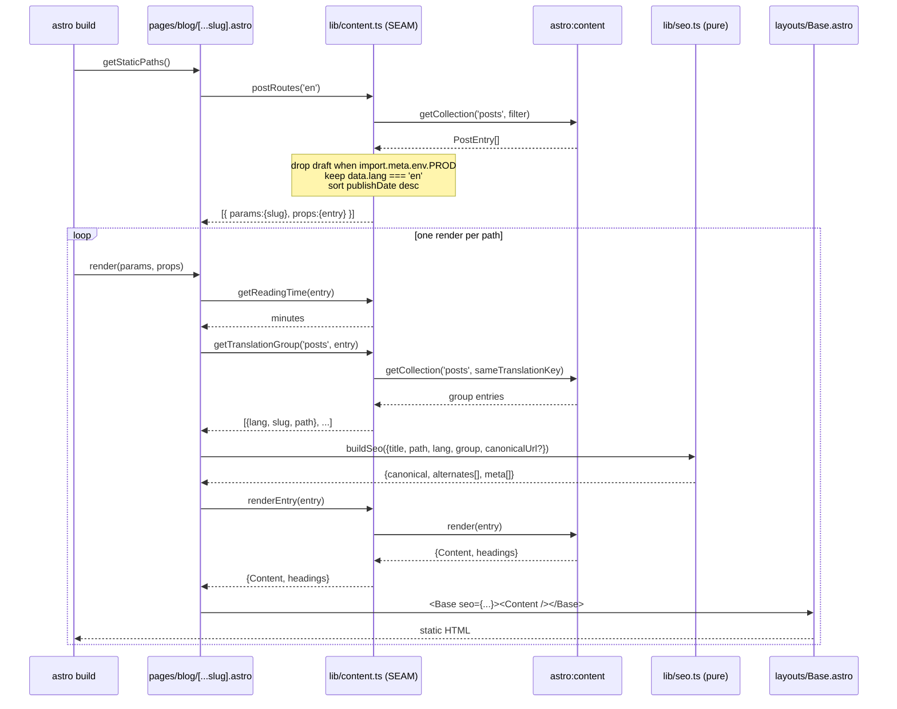

# Design: portfolio-scaffold

> Phase: `sdd-design` · Store: hybrid (`openspec/changes/portfolio-scaffold/design.md` + Engram `sdd/portfolio-scaffold/design`)
> Authority: `proposal.md` (approved, corrected by the orchestrator). Context: `exploration.md`, Engram #313 (verified Astro 7.3.3 APIs), #314 (i18n + boundaries), #315 (project context).
> Parallel phase: `sdd-spec` owns `specs/`. This document does not write there.

This is the **HOW**. The proposal settled what ships and why; this settles the module boundaries, the public function signatures, the enforcement algorithm, and the token system. Nothing here reopens D1 or D2.

---

## 1. Technical Approach

Five artifacts carry the entire architecture. Everything else in the scaffold is a consumer of one of them.

| Artifact | Role | Failure if wrong |
|---|---|---|
| `src/lib/content.ts` | The **only** value-importer of `astro:content`. All filtering, ordering, derivation, translation resolution and rendering pass through it | The boundary rule becomes decorative; a content-source change touches every page |
| `scripts/check-boundaries.mjs` | Mechanized enforcement of the layer rule, zero dependencies | The rule is documented, silently violated across AI sessions, and unwound later |
| `src/lib/seo.ts` | Pure URL/metadata computation: canonical, `hreflang`, override handling | Duplicate-content and wrong-alternate SEO damage that survives past the first deploy |
| `src/content.config.ts` | The typed authoring contract, including the `decisions[].rejected` forcing function | Every existing entry gets rewritten later |
| `src/styles/tokens.css` | The measurement system (colour, space, type). **Not** a design | Design decisions leak into the scaffold and pre-empt the user's own work |

The organizing principle is a **one-way dependency rule** with a **single data-access seam**:

```
pages ──▶ layouts ──▶ sections ──▶ content ──▶ ui
  │                                              
  └──────────────▶ lib ─────────────────────────▶ (astro:content, exactly one file)
```

`pages/` are the containers: they fetch. Everything below receives props. `lib/` is project-aware; `ui/` is project-agnostic and portable by definition.

### Directory tree

```
/
├── astro.config.mjs            site, static output, i18n, mdx, sitemap, fonts: []
├── package.json                4 deps, npm run check
├── tsconfig.json               extends astro/tsconfigs/strict
├── CLAUDE.md                   invariants for sessions that never touch SDD
├── scripts/
│   └── check-boundaries.mjs    ~40 lines, node stdlib only
└── src/
    ├── content.config.ts       3 collections, glob()/file(), astro/zod
    ├── content/                DATA, not a code layer
    │   ├── projects/*.mdx      2 seed entries
    │   ├── posts/*.mdx         2 seed entries
    │   └── links.json          2 seed entries
    ├── lib/                    project-aware modules
    │   ├── content.ts          ← THE SEAM
    │   ├── i18n.ts             dictionary + locale-aware paths
    │   └── seo.ts              pure: canonical, hreflang, meta
    ├── layouts/
    │   └── Base.astro          document shell + head. No visual design
    ├── pages/
    │   ├── index.astro
    │   ├── projects/index.astro
    │   ├── projects/[...slug].astro
    │   ├── blog/index.astro
    │   ├── blog/[...slug].astro
    │   ├── links.astro
    │   └── rss.xml.ts
    ├── components/             created empty-as-needed; the layers exist in the rule
    │   ├── ui/                 portable primitives
    │   ├── content/            entry-aware components
    │   └── sections/           composed, props-only
    └── styles/
        └── tokens.css          custom properties only
```

> **Scope clarification — `src/layouts/Base.astro`.** The proposal's Out-of-Scope row reads "Visual design, layout, components". That row means *visual* layout: grid, header, footer, chrome. `Base.astro` here is the **HTML document shell** — `<!doctype>`, `<html lang>`, the `<head>` block that `seo.ts` feeds, and one `<slot />`. Without it the `hreflang`/canonical rule is duplicated six times and cannot be verified once. It ships with **zero** styling beyond importing `tokens.css`. Flagged explicitly rather than smuggled in; if the orchestrator disagrees, the fallback is a `src/components/content/Head.astro` partial with the same content and one more import per page.

---

## 2. Architecture Decisions

### D3 — `src/lib/content.ts` is the only value-importer of `astro:content`, including `render()`

**Choice**: pages call `renderEntry(entry)` from `lib/content.ts`, which wraps `render()` from `astro:content`. No page, layout, or component imports `astro:content` in any form.

**Alternatives considered**:
- Restrict only `getCollection`/`getEntry` (the proposal's literal wording) and let pages import `render` directly.
- A repository/DDD wrapper around the collection API.

**Rationale**: the proposal's invariant is stated in terms of two function names, but the *checkable* form of the rule is "which files may value-import the module `astro:content`". A symbol-level rule needs the checker to parse import specifiers and track aliases (`import { getCollection as gc }`); a module-level rule is one string comparison. Widening the seam to cover `render()` makes the rule strictly simpler to enforce and costs one 3-line wrapper. The DDD wrapper was rejected in the proposal and remains rejected: there are no invariants to protect, so it would be indirection without benefit.

**Verification checkpoint (honest risk)**: `render()` in Astro 5+ resolves an entry against a build-time-generated render map. Wrapping it in a plain async function in another module is expected to work — the import still exists in the module graph — but this is asserted, not verified, because no scaffold exists yet. If `astro build` shows `render()` misbehaving through the wrapper, the bounded fallback is to allow `render` **and only `render`** to be imported from `astro:content` in `pages/` and `components/content/`, implemented as one allow-list entry in the checker. Recorded in Open Questions.

---

### D4 — Drafts are visible in `dev`, invisible in `build`

**Choice**: `const INCLUDE_DRAFTS = import.meta.env.DEV;` inside `lib/content.ts`. Every list and single-entry function applies it.

**Alternatives considered**:
- Always hide drafts, in dev too.
- An `INCLUDE_DRAFTS=true` environment variable to produce a draft preview build.

**Rationale**: a draft that cannot be previewed is a draft that cannot be edited — hiding them in dev makes the flag useless, since the only way to see the post is to un-draft it, which is exactly the state the flag exists to avoid. Publishing them is the opposite failure: unfinished work indexed by a crawler, permanently, from the first deploy. The dev server is the preview surface; that is what it is for.

The environment-variable escape hatch was rejected on a specific failure mode: a variable that can be set in a build environment *will* eventually be set in the deploy environment, and the failure is silent — the site builds fine and leaks drafts. A boolean derived from the build mode cannot be misconfigured.

**Gotcha to carry into tasks**: `import.meta.env.DEV` is `true` under `astro dev` and `false` under `astro build`. `astro preview` serves the already-built output, so drafts are absent there too — that is correct and intended, not a bug to report.

---

### D5 — `lang` is a required parameter, never a default

**Choice**: every collection-listing and single-entry function in `lib/content.ts` takes `lang: Locale` as a **required** field. There is no default value anywhere in the module.

**Alternatives considered**: `lang: Locale = 'en'`, which reads better at the ~8 call sites that exist today.

**Rationale**: the two options fail differently, and that asymmetry decides it. A required parameter fails **loudly and early**: the day `es` is added, `tsc` enumerates every call site that has not been considered, before the site is built. A default fails **silently and late**: `/es/blog/` renders successfully, with English content, indexed as Spanish. Nothing errors. Nobody notices until a Spanish reader or a search console does.

The cost of the required form is verbosity at a small, known number of call sites. The cost of the default is a class of bug with no build-time signal. D1 committed to adding Spanish later; a default is precisely the trap D1's "structure already in place" promise is supposed to prevent.

**Exception**: `listLinks()` takes no `lang`. The `links` collection is language-agnostic (social profiles, not prose). When link labels need translation they become dictionary keys in `lib/i18n.ts`, not a schema field.

---

### D6 — Derived fields are composed, never attached to the entry

**Choice**: `getReadingTime(entry)` is a pure exported function. List functions that need it return a wrapper object, not a mutated or widened entry:

```ts
export interface PostListItem {
  entry: Post;
  readingTime: number; // whole minutes, always >= 1
}
```

**Alternatives considered**:
1. Mutate: `entry.data.readingTime = n`.
2. Widen by spread: `{ ...entry, readingTime: n } as Post & { readingTime: number }`.
3. Author it in the schema.

**Rationale**: each alternative breaks something concrete.

1. **Mutation is not local.** The content layer caches entry objects, and `getCollection()` can hand back the *same object* across calls within a build. Mutating it means the field persists between calls and, worse, a recomputation could double-apply. It also fights the inferred entry type, requiring a cast at the assignment site.
2. **Spread produces a copy**, and `render(entry)` is handed an entry whose identity and internal fields the content layer owns. Passing a structural clone to `render()` is an unforced risk for no benefit.
3. **Authoring it violates "derive, don't author"**, already settled in the proposal, and produces a number that silently goes stale the moment the body is edited.

Composition costs one property access at the call site (`item.entry.data.title`) and has no type surgery, no casts, and no interaction with the content layer's object lifecycle. The detail page, which has the entry already, calls `getReadingTime(entry)` directly and never touches the wrapper.

---

### D7 — Flat content directories; `lang` comes from frontmatter, never from the path

**Choice**: `src/content/posts/*.mdx` and `src/content/projects/*.mdx` are flat. Language is `data.lang`. Entry ids are unique across the whole collection, regardless of language.

**Alternatives considered**: `src/content/posts/en/`, `src/content/posts/es/` with the language inferred from the path.

**Rationale**: with the `glob()` loader, `entry.id` is derived from the file path. A subdirectory makes the id `es/hola-mundo`, which then either appears in the URL (`/es/blog/es/hola-mundo`) or requires a strip-the-prefix transform that must be applied identically in routing, RSS, the sitemap, and `hreflang` — four places that must agree, with no mechanism forcing them to. Flat directories keep the invariant **`entry.id === URL slug`, with zero transformation**, so all four derive from the same string.

**Accepted cost**: two entries in different languages cannot share a filename. This is not a real constraint — a Spanish post should have a Spanish slug (`hola-mundo`, not `hello-world`), which is better for SEO anyway. If a collision ever happens the build does not break; `getTranslationGroup()` raises the ambiguity error described in D9.

---

### D8 — `seo.ts` is pure; `content.ts` does all fetching

**Choice**: `lib/content.ts` exports `getTranslationGroup()` (async, touches the collection). `lib/seo.ts` is synchronous and pure: it receives already-resolved translation links and turns them into canonical/alternate descriptors.

**Alternatives considered**: `seo.ts` resolves translations itself. It is in `lib/`, so `lib → lib` would be a legal import.

**Rationale**: legal and wise are different. The seam's value is that "which entries exist" is answered in one place; if `seo.ts` also fetches, there are two places that know how to find a counterpart entry, and they can disagree. Splitting on *data access vs. computation* also makes `seo.ts` trivially exercisable — every function takes plain values and returns plain values, with no collection needed to reason about it.

---

### D9 — `hreflang` emission mirrors `@astrojs/sitemap`'s verified rule

**Choice**: `getTranslationGroup()` returns the **full group including the entry itself**, so the group has length 1 when there is no counterpart. `seo.ts` then applies:

```
if (group.length <= 1) → emit NO <link rel="alternate"> at all
else                   → emit one per member, plus x-default → the 'en' member
```

**Rationale**: this is the exact shape of `createGetI18nLinks()` in `@astrojs/sitemap@3.7.4` (`dist/generate-sitemap.js`), whose operative line is `if (links.length <= 1) return void 0;`. Verified in source, per Engram #314 and the proposal. Making the head tags and the sitemap run the *same* predicate means they cannot drift: a page either has alternates in both, or in neither. Returning the self-entry in the group (rather than counterparts only) is what allows one uniform `<= 1` test instead of a two-branch "no key" / "key but no counterpart" special case.

**Ambiguity is a build error, not a silent pick**: if two entries in the same translation group share the same `lang`, `getTranslationGroup()` **throws**, naming both entry ids and the shared key. Zod cannot express cross-entry uniqueness, so this is the only place the constraint can live.

---

### D10 — A `canonicalUrl` override suppresses all `hreflang` alternates

**Choice**: when `data.canonicalUrl` is present on a post, `seo.ts` emits that URL as the canonical **and emits no alternates**.

**Rationale**: `hreflang` and `rel=canonical` must be consistent — each page in an alternates set is required to self-canonicalize. A cross-post that canonicalizes to an external original is explicitly *not* self-canonical, so advertising it as the Spanish/English alternate of anything sends search engines two contradictory instructions and typically gets the whole alternates cluster ignored. Suppression is the correct, conservative behavior.

**Accepted limitation**: `@astrojs/sitemap` includes every built page, so a cross-post still appears in `sitemap-index.xml` while canonicalizing elsewhere. Filtering it would require the sitemap `filter` callback to know which entries carry the override, and `astro.config.mjs` cannot import `astro:content`. This is cosmetic (search engines honor the on-page canonical) and is recorded as a risk rather than solved with a config-time hack.

---

### D11 — Explicit `trailingSlash: 'always'` + `build.format: 'directory'`

**Choice**: both set explicitly in `astro.config.mjs`. Every internal absolute URL in the project is produced by one function, `absoluteUrl()` in `lib/seo.ts`.

**Alternatives considered**: leave both at their defaults.

**Rationale**: canonical tags, `hreflang` alternates, the sitemap, and the RSS `<link>` elements must produce byte-identical URLs for the same page, or search engines see four variants of one document. With defaults, that agreement depends on how `@astrojs/sitemap` interprets `trailingSlash: 'ignore'` together with `build.format` — a two-default interaction that is correct today and could be re-derived incorrectly by a future session reading the config. Making both explicit costs two lines and removes the inference entirely. Routing that a reader can verify by reading the config beats routing that is correct by coincidence.

---

### D12 — No TypeScript path aliases

**Choice**: relative imports only. No `~/*` or `@/*` in `tsconfig.json`.

**Rationale**: `check-boundaries.mjs` resolves an import specifier to a repo path with `path.resolve(dirname(file), spec)` — one line, obviously correct. Adding aliases means the checker must re-implement tsconfig `paths` resolution, and if its implementation ever drifts from TypeScript's, the enforcement mechanism silently stops catching things. The enforcement being trivially correct is worth more than shorter import lines in a three-level-deep tree.

---

### D13 — `astro/tsconfigs/strict`, not `strictest`

**Choice**: `"extends": "astro/tsconfigs/strict"`.

**Rationale**: `strictest` additionally enables `exactOptionalPropertyTypes`, which distinguishes "property absent" from "property present and `undefined`". Zod's `.optional()` infers `T | undefined` as a *present* optional property, so every optional schema field becomes an assignment friction point at every seam that forwards it. The scaffold gets no safety from that distinction and pays for it everywhere. `strict` already includes `strictNullChecks`, which is what content collections actually require.

---

### D14 — Colour tokens use `light-dark()`, not a duplicated dark block

Covered in full in §7.

---

## 3. Data Flow

### Build-time flow for a collection detail page



Read the diagram for the property that matters: **every arrow into `astro:content` starts at `lib/content.ts`.** No other participant touches it.

### Enforcement flow

```
npm run check
   │
   ├─1─▶ node scripts/check-boundaries.mjs   (fastest, no build) ─▶ exit 1 stops the chain
   ├─2─▶ astro check                          (types, strict)
   └─3─▶ astro build                          (Zod schema validation, routes, sitemap, rss)
```

Cheapest check first: a boundary violation is caught in milliseconds instead of after a full type-check and build.

---

## 4. `src/lib/content.ts` — the public API

The single most important file in the change. Everything below is its complete exported surface; nothing else is public.

### Types

```ts
import { getCollection, getEntry, render, type CollectionEntry } from 'astro:content';

export type Locale = 'en' | 'es';

export type Project = CollectionEntry<'projects'>;
export type Post    = CollectionEntry<'posts'>;
export type Link    = CollectionEntry<'links'>;

/** Collections that are translatable. `links` is not. */
export type TranslatableCollection = 'projects' | 'posts';

export interface ListOptions {
  /** REQUIRED by design — see D5. There is no default locale in this module. */
  lang: Locale;
  /** Default 'newest'. Ordering key is publishDate. */
  order?: 'newest' | 'oldest';
  /** Applied after filtering and ordering. */
  limit?: number;
}

export interface ProjectListOptions extends ListOptions {
  /** Default false. true = only entries with featured: true. */
  featuredOnly?: boolean;
}

/** Derived data is composed, never attached to the entry — see D6. */
export interface PostListItem {
  entry: Post;
  readingTime: number;
}

export interface TranslationLink {
  lang: Locale;
  slug: string;
  /** Site-relative, locale-aware, trailing slash. e.g. '/es/blog/hola-mundo/' */
  path: string;
}

export interface EntryRoute<E> {
  params: { slug: string };
  props: { entry: E };
}
```

### Functions

| Function | Signature | Behavior |
|---|---|---|
| **listProjects** | `(o: ProjectListOptions) => Promise<Project[]>` | Drafts excluded when `PROD`; `data.lang === o.lang`; `featuredOnly` filter; sort by `publishDate`; `limit` last |
| **listPosts** | `(o: ListOptions) => Promise<PostListItem[]>` | Same filters; each entry wrapped with its computed `readingTime` |
| **listLinks** | `() => Promise<Link[]>` | `data.enabled === true` only; sorted ascending by `data.order`. No `lang` (D5 exception) |
| **getProject** | `(slug: string, lang: Locale) => Promise<Project \| undefined>` | `getEntry('projects', slug)`; returns `undefined` if missing, if `data.lang !== lang`, or if draft in `PROD` |
| **getPost** | `(slug: string, lang: Locale) => Promise<Post \| undefined>` | Same contract for `posts` |
| **projectRoutes** | `(lang: Locale) => Promise<EntryRoute<Project>[]>` | `getStaticPaths()` payload: `{ params:{slug}, props:{entry} }` |
| **postRoutes** | `(lang: Locale) => Promise<EntryRoute<Post>[]>` | Same for `posts` |
| **getTranslationGroup** | `(collection: TranslatableCollection, entry: Project \| Post) => Promise<TranslationLink[]>` | Full group **including self**. Length 1 when no `translationKey` or no counterpart. Drafts excluded in `PROD`. **Throws** on two members sharing a `lang` (D9) |
| **getReadingTime** | `(entry: Post \| Project) => number` | Pure. Whole minutes, minimum 1 |
| **renderEntry** | `(entry: Project \| Post) => Promise<RenderResult>` | Wraps `render()` from `astro:content` (D3) |

### Behaviors worth pinning down

**Draft gate (D4)** — one module-level constant, applied by every function above:

```ts
const INCLUDE_DRAFTS = import.meta.env.DEV;
const isVisible = (data: { draft: boolean }) => INCLUDE_DRAFTS || !data.draft;
```

**Why `getProject` still takes `lang` even though ids are globally unique (D7)** — it is an assertion, not a lookup key. A Spanish route resolving an English entry by slug must produce a 404, not an English page under a `/es/` URL. Returning `undefined` on a language mismatch is what makes that happen.

**`getStaticPaths` duplication** — `projectRoutes`/`postRoutes` exist so the English page and its future Spanish mirror share one implementation. The exploration flagged this duplication as a risk; this is the mitigation it asked for.

**Reading-time algorithm** — textual, deliberately:

```ts
const WORDS_PER_MINUTE = 200;

export function getReadingTime(entry: Post | Project): number {
  const prose = (entry.body ?? '')
    .replace(/```[\s\S]*?```/g, ' ')            // fenced code: not read at prose speed
    .replace(/`[^`\n]*`/g, ' ')                 // inline code
    .replace(/^\s*(?:import|export)\s.*$/gm, ' ') // MDX module statements
    .replace(/<[^>]+>/g, ' ')                   // HTML / JSX tags
    .replace(/!?\[([^\]]*)\]\([^)]*\)/g, '$1'); // links & images: keep the label
  const words = prose.split(/\s+/).filter(Boolean).length;
  return Math.max(1, Math.round(words / WORDS_PER_MINUTE));
}
```

`entry.body` is typed `string | undefined` for loader-backed entries, hence the `?? ''`. The estimate is approximate by nature; an npm `reading-time` package would be **outside the allowed dependency list** and is not worth approval for this.

**Route base map** — one constant, consumed by `getTranslationGroup` and by the pages:

```ts
const ROUTE_BASE = { projects: 'projects', posts: 'blog' } as const;
```

`posts` living at `/blog` is the only place where the collection name and the URL segment differ; it is centralized here so the divergence exists once.

---

## 5. `scripts/check-boundaries.mjs` — the algorithm

**Contract**: ~40 lines, `node:fs` + `node:path` only, no dependencies, no parser. Wired as the *first* step of `npm run check`.

### Step 1 — Enumerate

```js
import { readdirSync, readFileSync } from 'node:fs';
import { join, resolve, relative, dirname, extname } from 'node:path';

const CODE = new Set(['.astro', '.ts', '.tsx', '.mjs', '.js', '.mdx']);

const files = readdirSync('src', { recursive: true, withFileTypes: true })
  .filter((d) => d.isFile() && CODE.has(extname(d.name)))
  .map((d) => join(d.parentPath, d.name).replaceAll('\\', '/'));
```

`recursive: true` and `Dirent.parentPath` are both available on Node ≥ 22.12, which the project already requires. That is the whole traversal — no hand-rolled recursion.

`.mdx` is included deliberately: see the threat matrix in §9. MDX bodies are executable and can carry `import` statements.

### Step 2 — Classify the file into a layer

First match wins; the table is ordered longest-prefix first so the seam overrides `lib`.

| Order | Layer id | Path prefix |
|---|---|---|
| 1 | `seam` | `src/lib/content.ts` (exact file) |
| 2 | `lib` | `src/lib/` |
| 3 | `ui` | `src/components/ui/` |
| 4 | `content` | `src/components/content/` |
| 5 | `sections` | `src/components/sections/` |
| 6 | `layouts` | `src/layouts/` |
| 7 | `pages` | `src/pages/` |
| 8 | `entry` | `src/content/` (the `.mdx` bodies) |
| — | *(skipped)* | anything else under `src/` (e.g. `src/env.d.ts`) |

### Step 3 — Extract import statements

Two line-anchored regexes, no comment stripping:

```js
const FROM_RE = /^[ \t]*(?:import|export)\b[^'"]*?\bfrom[ \t]*['"]([^'"]+)['"]/gm;
const BARE_RE = /^[ \t]*import[ \t]*['"]([^'"]+)['"]/gm;
const DYNAMIC_RE = /\bimport[ \t]*\([ \t]*['"]([^'"]+)['"]/g;
const GLOB_RE = /\bimport\.meta\.glob[ \t]*\(/g;
```

Three deliberate constraints:

- **Line-anchored.** `^[ \t]*` means a line-commented import (`// import { getCollection } ...`) never matches, with no comment-stripping pass. Comment stripping by regex eats `//` inside string literals (URLs), which would cause *missed* imports; anchoring avoids the problem instead of mitigating it.
- **`[^'"]*?` before `from`.** The match cannot cross a string literal, so `export const SITE = 'https://x'` is not mistaken for a re-export.
- **`.astro` files are scanned frontmatter-only** — the text between the leading `---` fence and the next `---` at line start, with the line offset recorded for error reporting. A code sample in the template body that *displays* a forbidden import is therefore not a false positive. This directly retires the "false positives on `.astro` frontmatter" risk from the proposal.

**`import type` detection**: a statement is type-only **only** if it literally starts with `import type` / `export type`. The mixed inline form `import { type CollectionEntry } from 'astro:content'` is reported as a value import, with a message telling the author to rewrite it as `import type`. This is a deliberate convention squeeze: one canonical form is mechanically checkable in three characters, where per-specifier analysis is not checkable without a parser. It is a **false positive by design**, and the fix it demands is one the author should make anyway.

### Step 4 — Resolve the specifier

```js
const target = spec.startsWith('.')
  ? relative(process.cwd(), resolve(dirname(file), spec)).replaceAll('\\', '/')
  : spec;                                  // bare module: 'astro:content', 'astro/loaders', ...
const key = target.replace(/\.(astro|tsx?|m?js|mdx)$/, '');   // extension-insensitive
```

Deny entries are written extension-free (`src/lib/content`), so `../lib/content`, `../lib/content.ts` and `../../lib/content` all normalize to the same key. Specifiers ending in `.css` are allowed unconditionally and skipped before matching — a stylesheet import is not a dependency edge in this rule.

### Step 5 — Apply the forbidden-import matrix

Deny lists. A layer may import anything not on its list; deny always wins.

| Layer | MUST NOT import | Rule |
|---|---|---|
| `pages` | `astro:content` (any form, including `import type`) | B1 |
| `layouts` | `astro:content`, `src/lib/content`, `src/pages/` | B1, B2 |
| `sections` | `astro:content` value form, `src/lib/content`, `src/pages/`, `src/layouts/` | B1, B2 |
| `content` | `astro:content` **value** form (`import type` is allowed), `src/lib/content`, `src/pages/`, `src/layouts/`, `src/components/sections/` | B1, B2 |
| `ui` | `astro:content` (any form, incl. type), `astro:i18n`, `src/lib/`, `src/pages/`, `src/layouts/`, `src/components/sections/`, `src/components/content/` | B1, B3 |
| `lib` | `src/lib/content` is allowed (lib→lib); `src/pages/`, `src/layouts/`, `src/components/` forbidden | B2 |
| `seam` | `src/pages/`, `src/layouts/`, `src/components/` — and is the **only** file where `astro:content` is permitted at all | B1, B2 |
| `entry` (`src/content/**/*.mdx`) | `astro:content` (any form), `src/lib/content`, `src/pages/`, `src/layouts/` | B1, B2 |
| *any layer except* `seam` | `import('astro:content')` and `import.meta.glob(` | B4 |

Rule ids: **B1** = the single-seam invariant, **B2** = one-way layering, **B3** = `ui/` portability, **B4** = the bypass closers.

**Why `ui/` may not import `src/lib/` at all.** The classification heuristic is "could this be copied into another project and still work?". `src/lib/` is project-aware by definition — `content.ts` knows our collections, `i18n.ts` knows our dictionary, `seo.ts` knows our URL shape. A `ui/` component that imports any of them is no longer portable, so it is misclassified. The alternative — an exception list of "harmless" lib modules — was rejected because exception lists only grow, and the first exception is the one that makes the rule stop meaning anything. If a helper is genuinely portable, it belongs beside the component in `ui/`, not in `lib/`. That gives a one-sentence definition worth putting in `CLAUDE.md`: **`src/lib/` is project-aware; `src/components/ui/` is project-agnostic.**

### Step 6 — Report and exit

```
✖ src/components/ui/ProjectCard.astro:3
    rule  B3 — ui/ must not import 'astro:content'
    stmt  import type { CollectionEntry } from 'astro:content';
    fix   a component that knows a collection type belongs in src/components/content/

✖ src/components/sections/Featured.astro:5
    rule  B1 — only src/lib/content.ts may import 'astro:content'
    stmt  import { getCollection } from 'astro:content';
    fix   sections/ receive props; fetch in the page and pass them down

2 violations in 41 files checked.
```

Clean run: `✓ boundaries clean — 41 files, 8 layers, 4 rules.`

| Exit code | Meaning |
|---|---|
| `0` | No violations |
| `1` | One or more violations; every one printed, never short-circuited after the first |
| `2` | The checker itself failed (unreadable `src/`, bad invocation). Written to `stderr` |

Exit `2` is separated from exit `1` on purpose: "the rule was violated" and "the enforcement did not run" are different states, and collapsing them means a broken checker reads as a passing build.

### What this cannot catch — and why that is the right trade

| Not caught | Why | Assessment |
|---|---|---|
| Dynamic `import()` with a **computed** specifier | Needs evaluation, not text | The literal form `import('astro:content')` **is** caught by B4. A computed specifier requires deliberate construction |
| Re-export chains where every hop is individually legal | Needs a module graph | Each hop is itself classified and checked, so the chain can only be built out of legal edges — which means no layer ever gains an import it was denied |
| Runtime `fs.readFile('src/content/…')` | Not an import | `import.meta.glob` — the plausible accident — is caught by B4. A raw `fs` read of the content directory is not something a careless edit produces |
| Type errors, unused imports, anything semantic | Not this tool's job | `astro check` covers it, two steps later in `npm run check` |

**The argument for accepting these.** The rule exists because this repo is built across AI sessions with partial context, where only what breaks the build reliably survives (Engram #314). The failure mode being defended against is *a session that does not know the rule writes a normal top-of-file import*. Every such violation is static, line-anchored, and caught. The gaps all require deliberate circumvention, and at that point the rule is documented in `CLAUDE.md` and the author is knowingly working around it. This is a lock, not a vault — and a lock is the correct instrument, because the adversary is forgetfulness, not malice.

Adding a parser to close the remaining gaps would cost a dependency outside the allowed list, which is settled and not reopened here. The bounded mitigation already taken is rule **B4**, which closes the only two realistic bypasses (`import('astro:content')`, `import.meta.glob`) for two regex lines and zero dependencies.

**Self-test requirement**: the script must pass clean on the scaffold it ships with, and must fail on a deliberately introduced violation. Both are success criteria in the proposal; §8 turns them into verification steps.

---

## 6. `src/pages/rss.xml.ts` — feed construction

It is a page, so it **may** call `lib/content.ts` — and it **must not** call `getCollection()` (rule B1 catches it if it does).

```ts
import rss from '@astrojs/rss';
import type { APIContext } from 'astro';
import { listPosts, type Locale } from '../lib/content';
import { absoluteUrl } from '../lib/seo';

// ── every locale-dependent value lives in this one block ──
const LOCALE: Locale = 'en';
const FEED = {
  title: 'Jahat Trinidad — Blog',
  description: '…',
  language: 'en-us',
  base: '/blog',
} as const;
// ──────────────────────────────────────────────────────────

export async function GET(context: APIContext) {
  if (!context.site) {
    throw new Error('astro.config.mjs must define `site` before RSS can be generated.');
  }
  const posts = await listPosts({ lang: LOCALE });

  return rss({
    title: FEED.title,
    description: FEED.description,
    site: context.site,
    customData: `<language>${FEED.language}</language>`,
    items: posts.map(({ entry }) => ({
      title: entry.data.title,
      description: entry.data.description,
      pubDate: entry.data.publishDate,
      link: absoluteUrl(`${FEED.base}/${entry.id}`, context.site!).pathname,
      categories: entry.data.tags,
    })),
  });
}
```

| Concern | Decision | Rationale |
|---|---|---|
| **`site` resolution** | `context.site` with an explicit `throw` when undefined | `APIContext['site']` is `URL \| undefined` under `strict`, because TypeScript cannot see the config. A `!` assertion hides the failure; a thrown error names the exact fix and fails the build loudly. `astro.config.mjs` stays the single source of the origin |
| **Item links** | Built via `absoluteUrl()` from `seo.ts` | Same function as canonical tags and `hreflang`, so the feed cannot disagree with the rest of the site about trailing slashes (D11) |
| **English-only filter** | `listPosts({ lang: 'en' })` | D5 makes this explicit at the call site rather than implicit in a default |
| **Draft exclusion** | Inherited from `listPosts` (D4) | The feed cannot leak a draft, because it does not have its own filter to forget |
| **Full content** | **Not included.** Description-only feed | `@astrojs/rss`'s `content` field requires sanitized rendered HTML. Producing that from MDX needs either the experimental Container API or an HTML sanitizer (`sanitize-html`) — **outside the allowed dependency list, would require explicit user approval**. Not worth it for a scaffold; flagged in §10 |

**The per-locale split, later, without restructuring.** Every locale-dependent value is isolated in the `LOCALE` / `FEED` block at the top; the `GET` body contains no literal. The Spanish feed is then `src/pages/es/rss.xml.ts` with that block changed and the body copied — or, at that moment, a mechanical extraction of the body into `src/lib/feed.ts` taking `(locale, feedMeta, context)`, with both pages reduced to four lines.

**Why not extract to `lib/feed.ts` now**: there is exactly one caller. An abstraction built for a second caller that does not exist yet is a guess about its shape; the constant block gives the same structural readiness with no new file, and the proposal's file list stays accurate. The refactor is named here precisely so it is a known move rather than a rediscovery.

---

## 7. `src/lib/seo.ts` — canonical URLs and `hreflang`

Pure module. No `await`, no collection access (D8).

```ts
import type { Locale, TranslationLink } from './content';

export interface Alternate { hrefLang: string; href: string; }

export interface SeoInput {
  title: string;
  description: string;
  /** Site-relative path of THIS page, e.g. '/blog/hello-world' */
  path: string;
  lang: Locale;
  site: URL;
  /** Frontmatter override for cross-posted articles. Suppresses alternates (D10). */
  canonicalOverride?: string;
  /** From getTranslationGroup(); includes self; length 1 means "no counterpart". */
  group?: TranslationLink[];
  type?: 'website' | 'article';
  publishDate?: Date;
  updatedDate?: Date;
}

export interface SeoResult {
  canonical: string;
  alternates: Alternate[];
  title: string;
  description: string;
  openGraph: Record<string, string>;
}

export function absoluteUrl(path: string, site: URL): URL;
export function buildSeo(input: SeoInput): SeoResult;
```

### `absoluteUrl(path, site)` — the one URL normalizer

1. Ensure a single leading `/`.
2. Collapse any repeated `/`.
3. If the final segment contains a `.` (e.g. `/rss.xml`, `/og.png`), leave it alone — it is a file.
4. Otherwise ensure exactly one trailing `/` (matches `build.format: 'directory'` + `trailingSlash: 'always'`, D11).
5. Return `new URL(normalized, site)`.

Every absolute URL the project emits — canonical, alternates, `og:url`, RSS item links — goes through this function. Trailing-slash drift between these four is a classic duplicate-content source, and it is prevented structurally rather than by review.

### `buildSeo()` — canonical

```
canonicalOverride present ──▶ canonical = canonicalOverride (verbatim, external origin allowed)
                        │
                        └──▶ alternates = []            ← D10, hard stop
otherwise ─────────────────▶ canonical = absoluteUrl(path, site)
```

### `buildSeo()` — alternates

```
if (canonicalOverride)        → []                     // D10
if (!group || group.length <= 1) → []                  // D9, mirrors @astrojs/sitemap
else:
    for each member m in group:
        { hrefLang: BCP47[m.lang], href: absoluteUrl(m.path, site).href }
    plus { hrefLang: 'x-default', href: <href of the 'en' member> }
```

`BCP47 = { en: 'en-US', es: 'es-ES' }` — the same map given to `sitemap({ i18n: { locales } })` in `astro.config.mjs`. Both must use identical tags; the map is written once in `seo.ts` and the config repeats it literally, since `astro.config.mjs` cannot import from `src/`. That duplication is noted as a risk in §10 rather than hidden.

`x-default` points at the default locale, which is what a group of translated pages should advertise for unmatched languages.

### Emission site

`layouts/Base.astro` receives a `SeoResult` as a prop and renders the head. One file emits the tags; the rule is therefore verifiable in one place:

```astro
<link rel="canonical" href={seo.canonical} />
{seo.alternates.map((a) => <link rel="alternate" hreflang={a.hrefLang} href={a.href} />)}
```

Because `alternates` is `[]` for a page with no counterpart, the template emits nothing — no empty tag, no self-referential alternate. Same observable behavior as the sitemap.

---

## 8. `src/content.config.ts` — the authoring contract

```ts
import { defineCollection } from 'astro:content';
import { glob, file } from 'astro/loaders';
import { z } from 'astro/zod';   // Zod 4, bundled with astro. NEVER standalone zod.

const LOCALES = ['en', 'es'] as const;

const projects = defineCollection({
  loader: glob({ pattern: '**/*.mdx', base: './src/content/projects' }),
  schema: ({ image }) => z.object({
    title:          z.string(),
    description:    z.string(),                 // meta description + card teaser
    lang:           z.enum(LOCALES),
    translationKey: z.string().optional(),      // pairs an ES entry with its EN counterpart
    publishDate:    z.coerce.date(),
    updatedDate:    z.coerce.date().optional(),
    draft:          z.boolean().default(false),
    featured:       z.boolean().default(false),
    coverImage:     image().optional(),         // validated at build; missing file = Zod error
    coverImageAlt:  z.string().optional(),
    tags:           z.array(z.string()).default([]),   // what KIND of thing it is
    stack:          z.array(z.string()),               // what it was BUILT WITH
    role:           z.string(),                        // required — see below
    timeframe:      z.string(),                        // required — e.g. '2025 Q1–Q3'
    constraints:    z.array(z.string()).default([]),   // short records; narrative in the body
    outcome:        z.string().optional(),             // one-line quantified result for cards
    repoUrl:        z.string().url().optional(),
    demoUrl:        z.string().url().optional(),
    decisions: z.array(z.object({
      choice:   z.string(),   // what was done
      rejected: z.string(),   // what was discarded — REQUIRED, this is the forcing function (D2)
      because:  z.string(),   // the deciding constraint, one line
    })).default([]),
  }),
});

const posts = defineCollection({
  loader: glob({ pattern: '**/*.mdx', base: './src/content/posts' }),
  schema: z.object({
    title:          z.string(),
    description:    z.string(),
    lang:           z.enum(LOCALES),
    translationKey: z.string().optional(),
    publishDate:    z.coerce.date(),
    updatedDate:    z.coerce.date().optional(),
    draft:          z.boolean().default(false),
    tags:           z.array(z.string()).default([]),
    canonicalUrl:   z.string().url().optional(),  // cross-post → suppresses alternates (D10)
    // NO readingTime — derived in lib/content.ts (D6)
  }),
});

const links = defineCollection({
  loader: file('src/content/links.json'),
  schema: z.object({
    id:      z.string(),                       // required by the file() loader as the entry key
    label:   z.string(),
    url:     z.string().url(),
    icon:    z.string(),                       // key into an inline SVG sprite — no icon dependency
    order:   z.number().int(),                 // explicit sort key, not JSON array position
    enabled: z.boolean().default(true),        // retire a link without deleting the record
  }),
});

export const collections = { projects, posts, links };
```

### Field decisions worth defending

| Field | Decision | Rationale |
|---|---|---|
| `role`, `timeframe` | **Required** | They are the two things a hiring manager scans for first, and they are always knowable at authoring time. Required makes the schema the reviewer. Reversal is a one-character change (`.optional()`) if authoring two real case studies proves otherwise |
| `constraints` | `array(string).default([])` | Short records only. The narrative expansion stays in the MDX body under `## Constraints` |
| `decisions[].rejected` | **Required inside each item** | D2's forcing function: the build fails when a decision is recorded without its discarded alternative. `.default([])` on the array means an entry with *no* decisions still builds — the rule enforced is "no decision without its rejected alternative", not "every project must have decisions". That limit is deliberate and already recorded in the proposal |
| `translationKey` | `optional()` | Zod cannot express cross-entry uniqueness. The pairing integrity check lives in `getTranslationGroup()`, which throws on a same-language collision (D9) |
| `coverImage` | `image()` helper via the function form of `schema` | Validates the file exists at build time and returns an optimized, typed reference. A `z.string()` path fails later with no Zod-level signal |
| `stack` vs `tags` | Kept separate | Different questions: what it was built with vs. what kind of thing it is. Merging them makes the badge row and the taxonomy the same list, which is wrong for both |
| `order` on links | `z.number().int()` | Explicit sort key. JSON array position is fragile under edits and invisible in diffs |

### MDX body convention (documented, not schema-enforced)

`## Problem` · `## Constraints` · `## Decisions` · `## Alternatives rejected` · `## Outcome`

Frontmatter carries the queryable stub; the body carries the narrative. This split is the exploration's principle, accepted unchanged.

### Seed entries

Two per collection, and **between them** they must cover every field including every optional one, `translationKey`, and a populated `decisions[]`. Suggested split: entry A exercises the required minimum; entry B exercises every optional field. Both stay `lang: 'en'` — D1 creates no Spanish content — so `translationKey` is exercised as a *field* without a counterpart, which also exercises the `group.length <= 1` path in §7.

---

## 9. `src/styles/tokens.css` — the measurement system

**A measurement system, not a design.** Custom properties only. No selectors beyond `:root` and the theme hooks. No component styles, no layout, no chosen palette identity — the user designs the site himself; this file only gives him consistent units to design with.

### Structure

```css
@layer tokens, base, components, utilities;   /* cascade order, declared once, empty for now */

:root {
  color-scheme: light dark;

  /* ── 1. Primitives: raw values, never consumed directly by a component ── */
  --neutral-0:   #ffffff;
  --neutral-50 … --neutral-950;     /* a neutral ramp */
  --accent-100 … --accent-900;      /* one accent ramp, hue chosen later */

  /* ── 2. Semantic aliases: the ONLY tokens a component may use ── */
  --color-bg:            light-dark(var(--neutral-0),   var(--neutral-950));
  --color-surface:       light-dark(var(--neutral-50),  var(--neutral-900));
  --color-text:          light-dark(var(--neutral-900), var(--neutral-50));
  --color-text-muted:    light-dark(var(--neutral-600), var(--neutral-400));
  --color-border:        light-dark(var(--neutral-200), var(--neutral-800));
  --color-accent:        light-dark(var(--accent-600),  var(--accent-400));
  --color-accent-text:   light-dark(var(--neutral-0),   var(--neutral-950));
  --color-focus:         var(--color-accent);

  /* ── 3. Spacing: static rem, modular ratio 1.5 ── */
  --space-3xs: 0.25rem;  --space-2xs: 0.375rem; --space-xs: 0.5rem;
  --space-sm:  0.75rem;  --space-md:  1rem;     --space-lg: 1.5rem;
  --space-xl:  2.25rem;  --space-2xl: 3.375rem; --space-3xl: 5rem;

  /* ── 4. Type: fluid via clamp(min, preferred, max) ── */
  --font-size-xs:  clamp(0.75rem,  0.72rem + 0.15vw, 0.83rem);
  --font-size-sm:  clamp(0.875rem, 0.84rem + 0.18vw, 0.95rem);
  --font-size-md:  clamp(1rem,     0.96rem + 0.22vw, 1.13rem);
  --font-size-lg:  clamp(1.25rem,  1.18rem + 0.35vw, 1.5rem);
  --font-size-xl:  clamp(1.56rem,  1.44rem + 0.6vw,  2rem);
  --font-size-2xl: clamp(1.95rem,  1.74rem + 1.05vw, 2.66rem);
  --font-size-3xl: clamp(2.44rem,  2.1rem  + 1.7vw,  3.55rem);

  --line-height-tight: 1.15;
  --line-height-base:  1.6;
  --line-height-loose: 1.8;

  /* ── 5. Structure ── */
  --measure: 68ch;                 /* max line length for prose */
  --radius-sm: 0.25rem; --radius-md: 0.5rem; --radius-lg: 1rem;
  --border-width: 1px;

  /* ── 6. Font families: placeholders wired to the Fonts API later ── */
  --font-sans: system-ui, sans-serif;
  --font-mono: ui-monospace, monospace;
}

/* Manual override hook — no second token table needed */
[data-theme='light'] { color-scheme: light; }
[data-theme='dark']  { color-scheme: dark; }
```

### D14 — `light-dark()` instead of a duplicated dark block

**Choice**: each semantic token declares both values inline via `light-dark()`, with `color-scheme: light dark` on `:root`.

**Alternatives considered**:
1. `@media (prefers-color-scheme: dark) { :root { … } }` — a second full copy of the semantic block.
2. `[data-theme='dark'] { … }` — a second full copy, driven by a class/attribute.

**Rationale**: both alternatives duplicate the entire semantic token table, which means every future token must be added in two places and *will* eventually be added in only one — a token that silently keeps its light value in dark mode, with no build-time signal. `light-dark()` keeps one declaration per token, so the two values live on the same line and cannot drift.

The manual toggle falls out for free: `light-dark()` resolves against the nearest `color-scheme`, so setting `color-scheme: dark` on `[data-theme='dark']` flips every token underneath it with two rules and zero token duplication. That is the whole theme-switching mechanism, and it is three lines.

**Requirement**: `light-dark()` needs `color-scheme` set on the element or an ancestor — hence the `:root` declaration, which is not optional.

### The consumption rule

**Components consume semantic tokens only** (`--color-text`), never primitives (`--neutral-900`). Primitives exist to be re-pointed: changing the palette means editing the ramp, not every component. This is a convention, not a mechanized rule — `check-boundaries.mjs` enforces module dependencies, not CSS, and adding a CSS linter would cost a dependency outside the allowed list. Stated here and destined for `CLAUDE.md`.

### What this file deliberately does NOT contain

No reset/normalize, no element styles, no utility classes, no header/footer/grid, no chosen brand hue, no dark-mode toggle UI. `tokens.css` is imported once by `layouts/Base.astro` and nothing else in this phase reads from it. The `@layer` declaration reserves cascade order for the design phase that follows; its layers ship empty.

---

## 10. Build configuration

### `astro.config.mjs`

```js
import { defineConfig } from 'astro/config';
import mdx from '@astrojs/mdx';
import sitemap from '@astrojs/sitemap';

export default defineConfig({
  site: 'https://jahattrinidad.com',
  output: 'static',            // no adapter, no SSR
  trailingSlash: 'always',     // D11 — explicit, not inferred
  build: { format: 'directory' },

  i18n: {
    locales: ['en', 'es'],
    defaultLocale: 'en',
    routing: { prefixDefaultLocale: false },
    // fallback: MUST NOT be configured — see below
  },

  integrations: [
    mdx(),
    sitemap({ i18n: { defaultLocale: 'en', locales: { en: 'en-US', es: 'es-ES' } } }),
  ],

  fonts: [],                   // provider selection is a visual-design decision
});
```

| Key | Decision | Why |
|---|---|---|
| `routing.prefixDefaultLocale: false` | Frozen English URLs | `/blog/post/` never becomes `/en/blog/post/`. The load-bearing guarantee behind D1 |
| `routing.fallback` | **Absent, and must stay absent** | With `fallbackType: 'rewrite'` Astro serves default-locale content under `/es/` URLs with HTTP 200 — genuine duplicate content. A missing `/es/` route must 404. The prohibition is spec'd with its reason attached so it travels with the config |
| `sitemap({ i18n })` | Enabled now | Verified in `@astrojs/sitemap@3.7.4` source (`dist/generate-sitemap.js`): `createGetI18nLinks()` iterates actually-built URLs, and `if (links.length <= 1) return void 0;` means a page with no counterpart emits no `xhtml:link`. Inert today, self-activating when Spanish pages appear. **The published docs imply otherwise; the source is authoritative** |
| `markdown` | Left unconfigured | Sätteri is Astro 7's default processor (#313). `@astrojs/markdown-remark` must not be installed. Shiki theme selection is a visual decision, out of scope |
| `fonts: []` | Empty placeholder | Stable top-level key (#313), not `experimental.fonts`. If Astro 7 rejects an empty array at config validation, omit the key entirely — see Open Questions |

### `tsconfig.json`

```json
{
  "extends": "astro/tsconfigs/strict",
  "include": [".astro/types.d.ts", "**/*"],
  "exclude": ["dist"]
}
```

No `paths` (D12). `strict`, not `strictest` (D13).

### `package.json`

```json
{
  "type": "module",
  "engines": { "node": ">=22.12.0" },
  "scripts": {
    "dev": "astro dev",
    "build": "astro build",
    "preview": "astro preview",
    "check": "node scripts/check-boundaries.mjs && astro check && astro build"
  },
  "dependencies": {
    "astro": "7.3.3",
    "@astrojs/mdx": "8.0.1",
    "@astrojs/sitemap": "3.7.4",
    "@astrojs/rss": "4.0.19"
  }
}
```

`check` runs cheapest-first: a boundary violation fails in milliseconds rather than after a full type-check and build. `config.yaml` lists the three commands without mandating an order.

### Dependency justification (required by `rules.design`)

| Package | Version | Status | Justification |
|---|---|---|---|
| `astro` | 7.3.3 | ✅ allowed | The framework. Brings Zod 4 (`astro/zod`), Shiki 4, and Sätteri as direct deps — three dependencies avoided |
| `@astrojs/mdx` | 8.0.1 | ✅ allowed | Required for `.mdx` collection bodies with component imports |
| `@astrojs/sitemap` | 3.7.4 | ✅ allowed | Required for the i18n-aware sitemap whose `<= 1` rule §7 mirrors |
| `@astrojs/rss` | 4.0.19 | ✅ allowed | Required by the in-scope RSS feed |
| **Nothing else** | — | — | `astro/zod` replaces `zod`; bundled Shiki replaces Prism; the native Fonts API replaces `@fontsource`; Sätteri replaces `@astrojs/markdown-remark` |

**Flagged as requiring explicit user approval if ever reached for** (none introduced by this design):

| Package | Would be reached for | Why it is refused here |
|---|---|---|
| `sanitize-html` / `marked` | Full-content RSS (§6) | A description-only feed is sufficient for a scaffold |
| `reading-time` | §4's estimate | ~12 lines of regex replaces it |
| `eslint` + plugins, `dependency-cruiser` | §5's rule | Already rejected in the proposal: ~4 devDeps for one rule; `dependency-cruiser` cannot parse `.astro` |
| `tailwindcss` | §9 | Rejected independently by both analyses |

---

## 11. File Changes

| File | Action | Description |
|---|---|---|
| `package.json` | Create | 4 deps, `type: module`, `engines.node >= 22.12`, `npm run check` |
| `tsconfig.json` | Create | `astro/tsconfigs/strict`, no `paths` |
| `.gitignore` | Create | `node_modules`, `dist`, `.astro`, `.env*` |
| `astro.config.mjs` | Create | §10 |
| `CLAUDE.md` | Create | Seam invariant, layer matrix, `lib`-vs-`ui` definition, forbidden libraries, no-DDD decision, semantic-token rule, D1 revisit trigger |
| `scripts/check-boundaries.mjs` | Create | §5, ~40 lines, zero deps |
| `src/content.config.ts` | Create | §8 |
| `src/content/projects/*.mdx` | Create | 2 seed entries covering every field |
| `src/content/posts/*.mdx` | Create | 2 seed entries covering every field |
| `src/content/links.json` | Create | 2 seed entries, one with `enabled: false` |
| `src/lib/content.ts` | Create | §4 — the seam |
| `src/lib/i18n.ts` | Create | `en` dictionary + `localizedPath()` over `astro:i18n` |
| `src/lib/seo.ts` | Create | §7 — pure |
| `src/layouts/Base.astro` | Create | Document shell + head. **Scope clarification in §1** |
| `src/pages/index.astro` | Create | Home: featured projects + recent posts |
| `src/pages/projects/index.astro` | Create | Project list |
| `src/pages/projects/[...slug].astro` | Create | Detail; `getStaticPaths` → `projectRoutes('en')` |
| `src/pages/blog/index.astro` | Create | Post list with reading time |
| `src/pages/blog/[...slug].astro` | Create | Detail; `getStaticPaths` → `postRoutes('en')` |
| `src/pages/links.astro` | Create | Reads `links.json` via `listLinks()` |
| `src/pages/rss.xml.ts` | Create | §6 |
| `src/styles/tokens.css` | Create | §9 |
| `src/components/{ui,content,sections}/` | Create | Directories exist so the layer rule has somewhere to point; populated only as the skeleton pages need |
| `openspec/config.yaml` | Unchanged | Verify gate already names all three commands |
| `main` branch | Untouched | Holds the legacy portfolio |

**Totals**: ~22 new files, 0 modified, 0 deleted. No `src/fetch.ts`, no adapter, no Live Content Collections, no `src/content/config.ts` (the pre-Astro-5 path).

---

## 12. Testing Strategy

`strict_tdd: false`; no test runner is planned. The gate is the three functional checks plus four **negative verifications** run once and reverted.

| Layer | What to test | Approach |
|---|---|---|
| Types | Every module under `strict`; `lang` is genuinely required | `astro check` — 0 errors |
| Schema | Every field parses; `image()` resolves; required fields reject | `astro build` — Zod runs at build |
| Architecture | The 4 rules over 8 layers | `node scripts/check-boundaries.mjs` — exit 0 on the shipped tree |
| Routing | 6 routes build; no `/es/` in `dist/` | Inspect `dist/` after build |
| SEO | No `xhtml:link` in `sitemap-index.xml`; no `<link rel="alternate">` in any page head | Grep `dist/` |
| Feed | `/rss.xml` exists, is valid RSS 2.0, lists non-draft English posts only | Inspect `dist/rss.xml` |

### Negative verifications (perform once, confirm the failure, revert)

| # | Introduce | Expected |
|---|---|---|
| N1 | `import { getCollection } from 'astro:content'` in `src/components/ui/` | `check-boundaries.mjs` exits 1, rule **B3**, correct file and line |
| N2 | A `projects` `decisions` item missing `rejected` | `astro build` fails with a Zod error naming the path |
| N3 | A `draft: true` post | Visible under `astro dev`, absent from `dist/` and from `rss.xml` |
| N4 | Two entries sharing a `translationKey` with the same `lang` | `getTranslationGroup()` throws, naming both ids |

N1 and N2 are explicit success criteria in the proposal. N3 verifies D4 in both directions — the direction usually left untested is "visible in dev". N4 verifies the only integrity rule Zod cannot express.

---

## 13. Threat Matrix

Applicability screen: this design creates **Astro page routing** and one **Node script run by npm**. It creates no shell command composition, no subprocess spawning, no Git or PR automation, and no process integration. Four of the five rows are therefore `N/A`, and one is genuinely applicable.

| Boundary | Minimum adversarial cases | Applicability | Design response | Planned verification |
|---|---|---|---|---|
| Documentation-like paths | `requirements.txt`, `CMakeLists.txt`, **executable Markdown/MDX**, `README.sh` | **Applicable** — MDX is executable content that can carry `import` statements, and it lives under `src/content/`, outside every component layer | `.mdx` under `src/content/` is classified as its own layer, `entry`, with a deny list (§5 step 5): no `astro:content` in any form, no `src/lib/content`, no `src/pages/`, no `src/layouts/`. It is enumerated by the checker, not skipped as "data" | A seed entry importing `astro:content` in its MDX body is rejected by `check-boundaries.mjs` (extend N1) |
| Git repository selection | `git -C`, relative/absolute paths | **N/A** | The design invokes no Git. Branch handling is the orchestrator's | — |
| Commit state | staged, `commit -a`, empty index | **N/A** | No commit automation in this design | — |
| Push state | tracking branch, first push, refspec | **N/A** | Nothing is pushed or deployed by this change | — |
| PR commands | `--head`, env prefix, composed commands | **N/A** | No PR automation; `single-pr` delivery is human-driven | — |

The applicable row is a real find, not a formality: had MDX been skipped as "just content", an entry body could have imported `astro:content` directly and bypassed the seam with the checker reporting clean.

---

## 14. Migration / Rollout

**No migration required.** Nothing exists to migrate: branch `remake` is an orphan branch with zero commits, `main` is untouched, and nothing is deployed by this change.

Rollout is a single PR (`single-pr`, pre-accepted, with `size:exception` to be recorded by `sdd-tasks` — settled in the proposal, not reopened here).

The only irreversible decision is `prefixDefaultLocale: false`, and only *after* the first deploy. Nothing is published in this phase, so it stays freely changeable through the whole scaffold — which is precisely why it is being fixed now. Full rollback plan: see `proposal.md` §Rollback.

---

## 15. Open Questions

Non-blocking. Each has a named fallback, so `sdd-tasks` can proceed.

- [ ] **`renderEntry()` wrapper (D3)** — `render()` resolves entries against a build-time render map. Wrapping it in `lib/content.ts` is expected to work but is unverified (no scaffold exists). *Fallback*: allow `render` — and only `render` — to be imported from `astro:content` in `pages/` and `components/content/`, as one allow-list entry in the checker. **Verify during apply, at the first successful `astro build`.**
- [ ] **`fonts: []`** — whether Astro 7 config validation accepts an empty array. *Fallback*: omit the key entirely; the Fonts API is not used in this phase either way.
- [ ] **`id` in the `file()` loader schema** — kept, matching the documented example. *Fallback*: if build reports `id` unexpected in `data`, remove that one line. Low risk.
- [ ] **BCP-47 map duplicated** — `{ en: 'en-US', es: 'es-ES' }` exists in both `seo.ts` and `astro.config.mjs`, because `astro.config.mjs` cannot import from `src/`. The two must stay identical. Recorded as a risk below rather than hidden.
- [ ] **`src/layouts/Base.astro` scope** — reconciled against the proposal's Out-of-Scope row in §1 as a *document shell*, not visual layout. Flagged for orchestrator confirmation; the fallback is a `components/content/Head.astro` partial.

## 16. Risks introduced by this design

| Risk | Likelihood | Mitigation |
|---|---|---|
| BCP-47 locale tags drift between `seo.ts` and `astro.config.mjs` | Low | Both written in the same task; `CLAUDE.md` records that they are one decision in two files |
| A cross-post with `canonicalUrl` still appears in the sitemap while canonicalizing elsewhere | Low | Accepted (D10). Search engines honor the on-page canonical; filtering would need collection access inside `astro.config.mjs`, which is impossible |
| `import { type X }` inline form is reported as a violation | Medium | False positive **by design** (§5 step 3). The error message names the exact rewrite, and the rewrite is an improvement |
| Reading-time estimate is approximate for MDX with heavy component usage | Low | Acceptable for a portfolio; a package for it is outside the allowed dependency list |
| A future session adds a `lang` default to `lib/content.ts` "for convenience", silently reintroducing the D5 trap | Medium | D5's rationale goes into `CLAUDE.md` with the failure mode attached, not just the rule |
| `light-dark()` requires `color-scheme` on `:root`; deleting that line silently breaks every colour token | Low | Stated as a requirement in §9 and carried into `CLAUDE.md` |

---

## Traceability

| Proposal element | Where it is designed |
|---|---|
| D1 — i18n structure now, no `/es/` tree | §10 config, D5, D7, D9, §6 split plan |
| D2 — `decisions[].rejected` required | §8 schema |
| Content access seam | D3, §4, §5 rule B1 |
| Dependency-rule enforcement | §5 in full, §13 |
| Sitemap i18n inert-until-Spanish | §10 table, mirrored by D9 |
| `hreflang` only when the counterpart exists | D9, §7 |
| RSS English-only | §6 |
| Base design tokens, no design | §9 |
| Allowed-dependency list | §10 justification table |
| `npm run check` | §10, §3 enforcement flow |

---

## Orchestrator Decisions

Two open items were flagged by `sdd-design` rather than decided unilaterally. Both are resolved here; neither changes the design.

### 1. `src/layouts/Base.astro` — APPROVED, and it was never out of scope

The design read the proposal's Out-of-Scope row ("Visual design, layout, components") as meaning *visual* layout, and asked for confirmation.

Confirmed, on stronger grounds than the proposal: the user's own architecture sketch, given in the original brief, lists `layouts/` as a top-level directory alongside `pages/` and `components/`. The proposal's Affected Areas table simply omitted it. The user's brief outranks a table that forgot a row.

The supporting argument is also correct on its own: without a document shell the `hreflang`/canonical rule is duplicated across six pages and cannot be verified in one place. A rule enforced in six files is a rule that will drift in one of them.

Ships with zero styling beyond importing `tokens.css`. The `Head.astro` fallback is not needed.

### 2. Widening the content seam to cover `render()` — APPROVED

The proposal's literal wording was "`getCollection()` / `getEntry()` in exactly one file". The design widened the rule to "which files may import the module `astro:content`", which additionally captures `render()`.

Approved, for the reason given: a symbol-level rule requires alias tracking and therefore a parser, which the zero-dependency constraint forbids. A module-level rule is one string comparison. **The stricter rule is the only checkable rule**, and an unenforceable rule is not a rule.

It is also consistent with the boundary already agreed for `ui/`, which may not import `astro:content` at all — not even as a type. Widening here aligns the two rather than adding a new concept.

Recorded consequence: `renderEntry()` in `src/lib/content.ts` becomes the single wrapper through which pages obtain `<Content />`.

### Carried forward to `sdd-tasks`

- The `renderEntry()` wrapper is **asserted, not verified** — `render()` resolves against a build-time map and no scaffold exists yet to test against. This must be confirmed at the first successful `astro build`; the specified fallback is a `render`-only allow-list entry in the boundary checker. Tasks must include this verification explicitly rather than assuming it.
- The D1 i18n revisit trigger (reopen before the first substantial batch of UI copy) must survive into `tasks.md`. A decision to revisit that lives only in a proposal nobody rereads is a decision that never gets revisited.
- The boundary checker has two success criteria, not one: it must pass on the shipped scaffold **and** fail on a deliberately introduced violation. The second requires a verify-then-revert step.
