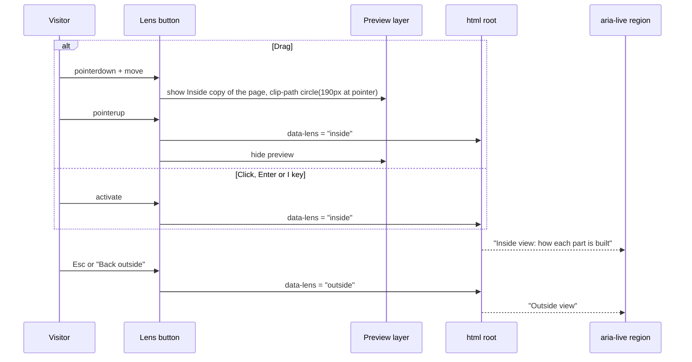
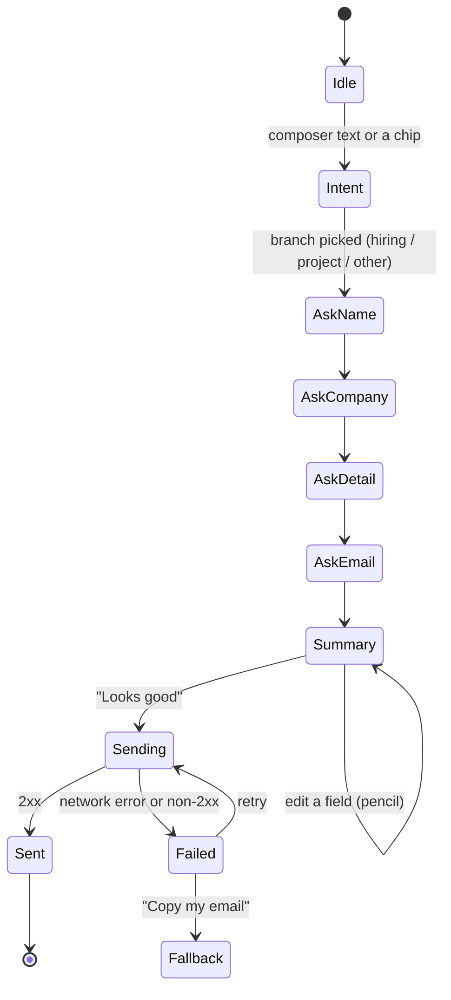

# Design: portfolio-implementation

Values (colors, type sizes, spacing, layer order, Figma node ids) come from `openspec/changes/portfolio-visual-design/design.md`. This file covers how the code is organised and the flows that need more than a sentence.

## 1. Component layers

The boundary checker already knows these layers (`scripts/check-boundaries.mjs`, `LAYER_ORDER`). This change creates them.

| Layer | Path | Holds | Rules |
|---|---|---|---|
| ui | `src/components/ui/` | Portable pieces: `Icon`, `Button`, `Chip`, `Annotation`, `CodeBlock` chrome, `Tag` | No `astro:content`, no `astro:i18n`, no `src/lib/` (B3). Text arrives as props. |
| content | `src/components/content/` | Pieces that render one entry: `ProjectCard`, `PostRow`, `ExperienceRow`, `CaseStudyFact` | May `import type` entry types; no runtime content imports. |
| sections | `src/components/sections/` | Page sections: `Hero`, `Values`, `Work`, `Experience`, `Notes`, `Contact`, `Nav`, `Footer`, `Backgrounds`, `Lens` | Receive props, never fetch. |
| layouts | `src/layouts/` | `Base.astro` (shell, nav, footer, lens root) | |
| pages | `src/pages/` | Fetch through `src/lib/content.ts`, read the dictionary, pass props down | |

The chat engine (`src/components/sections/contact/chat-engine.ts`) is a plain TypeScript module next to its section. It imports nothing from `src/lib/`; the questions and copy arrive from the page as serialized props, so the engine stays testable on its own.

## 2. Outside / Inside state

```
<html data-lens="outside|inside">
  :root                      { color-scheme: light }
  :root[data-lens="inside"]  { color-scheme: dark }
```

- Every color token is `light-dark(outsideValue, insideValue)`. Components never read `data-lens`; they only use tokens.
- Copy that differs between states is rendered twice in the markup, `data-show="outside"` and `data-show="inside"`, and CSS hides the inactive one (`display: none`, so screen readers skip it too). No JavaScript is needed to show the right copy after a switch.
- The state is not persisted between visits: every visit starts Outside (the public face). The Inside state lives for the page view and survives navigation within Home only.
- Case study, Work index and Notes pages have no lens (D21) and stay Outside.

### Lens interaction



- **Preview layer:** one `aria-hidden` clone of the page content with `data-lens="inside"` on its own root. Because `color-scheme` inherits, the clone resolves every token to its Inside value without extra CSS. It is clipped to a circle that follows the pointer. Task 4.1 measures this before the rest of Inside is built; if the clone is too heavy, the fallback is a preview limited to the section under the pointer.
- **I shortcut (WCAG 2.1.4):** ignored while focus is in an input, textarea or contenteditable (the chat composer); a control in the footer turns it off.
- **Touch:** dragging works with pointer events; the hint reads "Tap the lens".
- **Reduced motion:** the switch is instant; the preview circle still works because it follows the pointer and does not animate by itself.

## 3. Contact chat

A scripted conversation that collects a few fields, shows an editable summary and sends it through a form service. No language model. The goal is that it reads as a conversation, not as a form.

### States



The real questions per branch come from the chat design (visual-design task 7.11). The diagram shows the shape, not the final copy.

### What makes it feel conversational

| Technique | Rule |
|---|---|
| Typing delay | Before each reply, a typing indicator for `min(400 + 18 ms × characters, 1400 ms)`. Zero under reduced motion. |
| Echo | Replies use the fields already captured ("Thanks, {name}. What's the role at {company}?"). |
| Skip what is known | The first free-text message is scanned: an email address (regex) fills Email; keywords (`intern`, `hiring`, `role`, `job` → hiring; `project`, `build`, `freelance` → project) pick the branch. Questions already answered are skipped. |
| Context placeholder | The composer placeholder changes with each question. |
| Corrections | Every field in the summary has a pencil that reopens that question only. |
| Payoff | After "Sent", one useful next step per branch: hiring → the Inspiration Garden case study and the CV; project → the Work index. |

### Engine contract

```ts
type ChatState = { step: Step; fields: Partial<Fields>; branch?: Branch; error?: string };
type ChatEvent =
  | { type: 'submit'; text: string }
  | { type: 'chip'; value: string }
  | { type: 'edit'; field: keyof Fields }
  | { type: 'confirm' }
  | { type: 'sent' }
  | { type: 'failed'; reason: string };

function next(state: ChatState, event: ChatEvent, script: ChatScript): ChatState;
function detect(text: string): { email?: string; branch?: Branch };
```

- `next` and `detect` are pure. The DOM layer renders `state` and calls the form service on `Sending`.
- Tests (`node --test`) cover: each branch end to end; skipping a question when the first message already answered it; editing a field from the summary returns to the summary; a failed send keeps the fields; invalid email is asked again.

### Sending

`POST` with `fetch` to the Web3Forms endpoint (configured in one constant; its access key is public by design). Payload: branch, name, company, detail, email, and a plain-text body built from the email template. Honeypot field included. On failure the summary stays on screen with a retry and the "Copy my email" fallback.

## 4. Routes and paths

- `ROUTE_BASE` changes to `{ projects: 'work', posts: 'notes' }`.
- `src/lib/content.ts` exposes the path builder it already has privately (`entryPath`), so pages, RSS and SEO stop hardcoding `/projects/` and `/blog/`. Every internal link goes through it or `localizedPath`.
- Collection names (`projects`, `posts`) stay; they are internal.

## 5. Images

- Hero layers are exported from Figma (visual-design `assets.md`, D8: not in git as source files) into `src/assets/hero/` as web-sized files: sky and far hills (3400 w), near hill rotated 5° on transparency (2952 × 2104), portrait with alpha (1400 w). The exported web versions are committed; the full-size working files stay out of git.
- All images go through `astro:assets` (`<Picture>` with AVIF and WebP, responsive widths).

## 6. Testing and checks

No test runner dependency (config `strict_tdd: false`). Checks per task:

- `npm run check` (boundaries, `astro check`, build).
- `node --test` for the chat engine (wired into `npm run check` once the engine exists).
- Visual check against the Figma board at 390, 768 and 1440 for every page task.
- Keyboard and screen reader walk-through for the lens, the nav menu and the chat.

## 7. Motion (Phase 9, approved on the running site 2026-11-19/20; polished 2026-11-20 in v1.3.0)

Library: **GSAP 3.15.1 with ScrollTrigger**, pinned exactly (added 2026-11-19, `307165e`; Standard no-charge license). Owner: "hazlo con gsap, aprovechemos que tenemos herramientas que nos van a facilitar las cosas". It is bundled only into the Home page's scripts (≈114 KB minified, ≈44 KB gzip). Rules for every piece below: animate only `transform` and `opacity` (or a `clip-path` on a one-off reveal), never `backdrop-filter`, `background`, height or layout; transitions are interruptible; `prefers-reduced-motion: reduce` gets no movement; without JS nothing is left half-hidden.

Since v1.3.0 the site also uses **Lenis 1.3.25**, pinned exactly (MIT), for smooth wheel scrolling on every page; owner: "lo siguiente es el scroll suave de esa página [pryzm.design]. me gustaría adaptarlo a la nuestra". Its settings are the reference's, read from its bundle. GSAP drives it (one ticker), so every scrubbed piece follows the eased position.

Pointer-driven pieces (the name tilt, the magnetic CTAs) use the individual `translate` / `rotate` properties so they add to GSAP's transforms; GSAP writes `translate: none; rotate: none` inline on every element it transforms, so the CSS for those needs `!important`. A pointer follower integrates a spring per frame and measures the rest position from the offset it wrote; restarting an eased tween on every pointer event, or measuring from the target, feels choppy.

| Piece | Where | Behaviour | Values |
|---|---|---|---|
| Nav states | `Nav.astro` | Glass (Scrolled) from the first pixel of scroll via a 1 px sentinel; on Home the logo is hidden while the hero's name is still seen (more than a quarter of its height between the bar and whatever covers it: the viewport's bottom or the rising glow, via `glow/cover.ts` and its `glow-cover-change` event) and while the mobile menu is closed. The glass lives on its own layer and fades. Current section: a soft pill (the heading at 8 % / 12 %, the mobile sheet's current-language tint) slides behind the current desktop link and fades out when none is current; the spy takes the listed section crossing a line at 30 % of the viewport, every scroll frame, on Home only (elsewhere the route marks the link). | Docking 240 ms ease-out; back to floating slower: bar opacity 480 ms, row 560 ms `cubic-bezier(0.25, 1, 0.5, 1)`; logo out 180 ms. Pill 420 ms `cubic-bezier(0.23, 1, 0.32, 1)`, 1.75 rem wider than the link, 2.25 rem tall, fades in place when it reappears. Brand hand-off at scrollY ≈ 260 at 1440 × 900. Reduced motion: short fades only. |
| Hero load ("sun reveal") | `Hero.astro` | The hero starts clipped to a sun-sized circle on the page surface (never its own fill, which caused a green frame), and opens from the sun once the sky image can paint. Each text block fades in only once the circle encloses all of it; the name rises from behind the hill when the circle reaches it; the portrait steps up into the frame; the nav and the lens dock come in last. Runs only at the top of a fresh load. | Circle 22 px → farthest hero corner, `expo.inOut`, 1.6 s, waits ≤ 0.7 s for the sky to decode. Name `yPercent` 55 → 0, 1.1 s `expo.out`. Portrait y 160 → 0, 1.6 s `power3.out`, opacity in 0.6 s. Text: opacity + 12 px, 0.5 s. Lens dock: opacity + `--scale` 0.4 → 1 `back.out(2.2)`. A 3.5 s safety timeout releases the starting state if the script fails. Dispatches `hero-intro-done` on `window`. |
| Hero parallax | `Hero.astro` | Depth by lag: far layers fall behind the page as the hero leaves, so the sun and the name sink. The hill and the portrait move with the page (the portrait is cropped by the hero bottom and must never rise past it). Inside, the sky and name annotations ride with their layers inside hero-sized `.follow` wrappers. Pointer (fine pointer only): the big name alone tilts toward the pointer in perspective, a 2.5D effect behind the hill; nothing else follows the pointer (a sky drift was tried and dropped). | Scrubbed from hero top to hero bottom, `scrub: 0.4`: sky + sun mask y = 35 % of the hero height, name y = 18 %. (Resolves visual-design Open Question 7.) Tilt: `rotate: -my mx 0 hypot(mx, my) × 14deg` plus `translate` 14 / 8 px, `perspective: 1100px` from the name's centre on the hero and on the portrait outline (so the outline copy stays registered), eased with `gsap.quickTo` 1.2 s `power3.out`. |
| Section glow transitions | `GlowTransition.astro`, placed in `Home.astro` before Values and before Contact | What moves is a section's own surface, with a lit rim (the reference's planet limb, annnimate.com "Horizon Gradient", told with golden-hour light). **Rise** (hero → What you get): the Values surface climbs over the hero; its arc starts round and flattens. **Descend** (Notes → Contact): the layer hangs from the bottom of Notes, which paints above Contact (content included), and pulls back up: its edge enters at the viewport's bottom and sweeps to the top, uncovering Contact as it passes; its glow ends at the top. Contact gets 30vh of room above its content while it runs, with a negative `scroll-margin-top` so the nav link lands under the bar. Rim: a light arc (pale sun → sun) with a warm core at its crest (apricot `#fac869`, ember `#f4a95e`, sampled from `sky.png`), darker at the centre and lighter toward the ends. Inside: all `green-300`, faint. The neighbours' `[data-backgrounds]` fade over 240 px at the seam. Chromatic aberration was tried and dropped. | Two radial gradients (warm core on top; body to 75 % then wide soft stops), transform only, no pin, `scrub: 0.3`. Rise: from Values entering to its top at 30 % of the viewport (from scroll 0 when it already shows at load, keeping the length), yPercent 0 → −55, scaleX 0.75 → 3.2, opacity 0 → 1 over the first 6 %. Descend: from Contact's top at 60 % of the viewport to the top, edge from 0.4 viewport below the seam to the seam (yPercent computed from the layer's size), scaleX 0.8 → 1.6. |
| Lens drag | `Lens.astro` | The x-ray circle grows out of the lens when a drag starts, centred on the lens (under the finger on touch too, no lift). | Lens radius → 190 px over 280 ms, cubic ease-out, stepped per frame; the ring scales with it; a drop mid-growth reveals from the current radius. |
| Lens switch | `Lens.astro` | The new state opens in a circle from where the gesture happened: the lens (click or I), the dropped x-ray circle (drag), the Back outside button (its click or Esc). View Transition: the circle animates `clip-path` on `::view-transition-new(root)`; `html[data-lens-reveal]` turns the default crossfade off. | `cubic-bezier(0.87, 0, 0.13, 1)` (expo in-out, same family as the load), 900 ms; start radius = the control's radius or the x-ray circle's 190 px. Reduced motion or no View Transitions: instant switch. |
| Lens idle shake | `Lens.astro` | Until the visitor first uses the lens (click, drag or an I that actually switches; remembered in `localStorage` `lens-discovered`, which is why it never shakes again in a browser that used it), it knocks side to side so the curious hover it and read its hint. Only Outside, never while hovered, focused, dragged or in a background tab. The Outside hero no longer prints "drag the lens, or press I…" (owner removed it on the board). | Side-to-side `translate` up to 7 px with a slight `rotate` (a pure rotation of a round button reads as no motion), 0.75 s. First shake 1.2 s after `hero-intro-done` (6 s fallback), then every 7 s; each shake clears, reflows and re-sets `data-nudge`. Reduced motion: none. |
| Smooth scroll | `SmoothScroll.astro`, mounted in `Base.astro` | Eased wheel scrolling and in-page anchors on every page; touch keeps the native scroll. Stops while the mobile menu is open (`html[data-menu-open]`); the sheet and the chat log keep their own scroll (`data-lenis-prevent`). | `lerp: 0.1`, `smoothWheel`, `anchors` (pryzm.design's settings); `gsap.ticker` drives `lenis.raf`, `lagSmoothing(0)`, `lenis.on('scroll', ScrollTrigger.update)`. Reduced motion: no Lenis. |
| Magnetic CTAs | `ui/Magnetic.astro`, mounted in `Base.astro`; any element with `data-magnetic` (nav Contact, hero CTA, case study buttons) | The element leans toward the pointer once it is near, and springs back with a small overshoot (behaviour measured from viora-website.vercel.app's nav CTA). | Zone 70 px around the element, strength smoothstep from its edge, full over the element: offset = pointer's place from the centre / half-size × 14 px. Damped spring per frame: period 0.42 s, damping 0.8 held, 0.42 released. Fine pointer only; reduced motion: none. |

Verification method used for all of it (and to repeat after any change): check in the browser at rest, at one wheel step (~40 px), mid and end, at the owner's size (≈1855 × 989) plus 1440 × 900 and 390 × 844, in both lenses; measure timing with Playwright (`goto` with `waitUntil: 'commit'` and timed samples) and under CDP CPU throttling ×6. Codex agents cannot see the browser from their sandbox, so motion is tuned inline.
