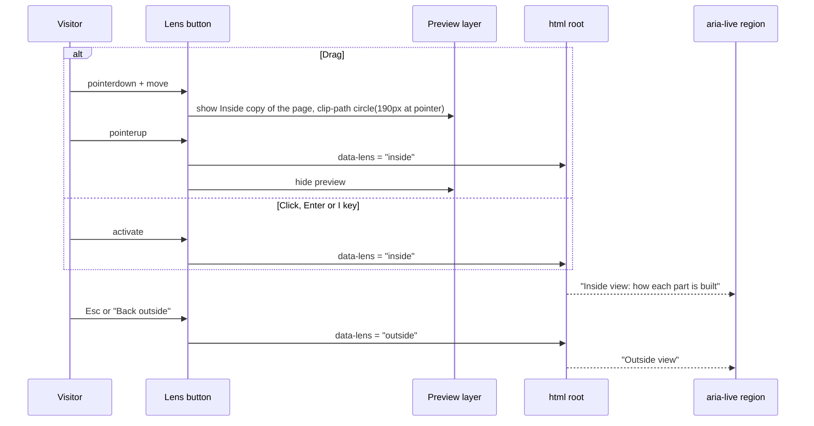
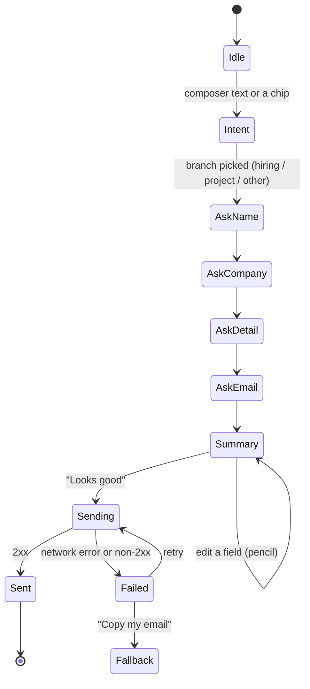

# Design: portfolio-implementation

Values (colors, type sizes, spacing, layer order, Figma node ids) come from `openspec/changes/portfolio-visual-design/design.md`. This file covers how the code is organised and the flows that need more than a sentence.

## 1. Component layers

The boundary checker already knows these layers (`scripts/check-boundaries.mjs`, `LAYER_ORDER`). This change creates them.

| Layer | Path | Holds | Rules |
|---|---|---|---|
| ui | `src/components/ui/` | Portable pieces: `Icon`, `Button`, `Chip`, `Annotation`, `CodeBlock` chrome, `Tag` | No `astro:content`, no `astro:i18n`, no `src/lib/` (B3). Text arrives as props. |
| content | `src/components/content/` | Pieces that render one entry: `ProjectCard`, `PostRow`, `ExperienceRow`, `CaseStudyFact` | May `import type` entry types; no runtime content imports. |
| sections | `src/components/sections/` | Page sections: `Hero`, `Values`, `Work`, `Experience`, `Notes`, `Contact`, `Nav`, `Footer`, `Backgrounds`, `Lens` | Receive props, never fetch. |
| layouts | `src/layouts/` | `Base.astro` (shell, nav, footer, lens root) | |
| pages | `src/pages/` | Fetch through `src/lib/content.ts`, read the dictionary, pass props down | |

The chat engine (`src/components/sections/contact/chat-engine.ts`) is a plain TypeScript module next to its section. It imports nothing from `src/lib/`; the questions and copy arrive from the page as serialized props, so the engine stays testable on its own.

## 2. Outside / Inside state

```
<html data-lens="outside|inside">
  :root                      { color-scheme: light }
  :root[data-lens="inside"]  { color-scheme: dark }
```

- Every color token is `light-dark(outsideValue, insideValue)`. Components never read `data-lens`; they only use tokens.
- Copy that differs between states is rendered twice in the markup, `data-show="outside"` and `data-show="inside"`, and CSS hides the inactive one (`display: none`, so screen readers skip it too). No JavaScript is needed to show the right copy after a switch.
- The state is not persisted between visits: every visit starts Outside (the public face). The Inside state lives for the page view and survives navigation within Home only.
- Case study, Work index and Notes pages have no lens (D21) and stay Outside.

### Lens interaction



- **Preview layer:** one `aria-hidden` clone of the page content with `data-lens="inside"` on its own root. Because `color-scheme` inherits, the clone resolves every token to its Inside value without extra CSS. It is clipped to a circle that follows the pointer. Task 4.1 measures this before the rest of Inside is built; if the clone is too heavy, the fallback is a preview limited to the section under the pointer.
- **I shortcut (WCAG 2.1.4):** ignored while focus is in an input, textarea or contenteditable (the chat composer); a control in the footer turns it off.
- **Touch:** dragging works with pointer events; the hint reads "Tap the lens".
- **Reduced motion:** the switch is instant; the preview circle still works because it follows the pointer and does not animate by itself.

## 3. Contact chat

A scripted conversation that collects a few fields, shows an editable summary and sends it through a form service. No language model. The goal is that it reads as a conversation, not as a form.

### States



The real questions per branch come from the chat design (visual-design task 7.11). The diagram shows the shape, not the final copy.

### What makes it feel conversational

| Technique | Rule |
|---|---|
| Typing delay | Before each reply, a typing indicator for `min(400 + 18 ms × characters, 1400 ms)`. Zero under reduced motion. |
| Echo | Replies use the fields already captured ("Thanks, {name}. What's the role at {company}?"). |
| Skip what is known | The first free-text message is scanned: an email address (regex) fills Email; keywords (`intern`, `hiring`, `role`, `job` → hiring; `project`, `build`, `freelance` → project) pick the branch. Questions already answered are skipped. |
| Context placeholder | The composer placeholder changes with each question. |
| Corrections | Every field in the summary has a pencil that reopens that question only. |
| Payoff | After "Sent", one useful next step per branch: hiring → the Inspiration Garden case study and the CV; project → the Work index. |

### Engine contract

```ts
type ChatState = { step: Step; fields: Partial<Fields>; branch?: Branch; error?: string };
type ChatEvent =
  | { type: 'submit'; text: string }
  | { type: 'chip'; value: string }
  | { type: 'edit'; field: keyof Fields }
  | { type: 'confirm' }
  | { type: 'sent' }
  | { type: 'failed'; reason: string };

function next(state: ChatState, event: ChatEvent, script: ChatScript): ChatState;
function detect(text: string): { email?: string; branch?: Branch };
```

- `next` and `detect` are pure. The DOM layer renders `state` and calls the form service on `Sending`.
- Tests (`node --test`) cover: each branch end to end; skipping a question when the first message already answered it; editing a field from the summary returns to the summary; a failed send keeps the fields; invalid email is asked again.

### Sending

`POST` with `fetch` to the Web3Forms endpoint (configured in one constant; its access key is public by design). Payload: branch, name, company, detail, email, and a plain-text body built from the email template. Honeypot field included. On failure the summary stays on screen with a retry and the "Copy my email" fallback.

## 4. Routes and paths

- `ROUTE_BASE` changes to `{ projects: 'work', posts: 'notes' }`.
- `src/lib/content.ts` exposes the path builder it already has privately (`entryPath`), so pages, RSS and SEO stop hardcoding `/projects/` and `/blog/`. Every internal link goes through it or `localizedPath`.
- Collection names (`projects`, `posts`) stay; they are internal.

## 5. Images

- Hero layers are exported from Figma (visual-design `assets.md`, D8: not in git as source files) into `src/assets/hero/` as web-sized files: sky and far hills (3400 w), near hill rotated 5° on transparency (2952 × 2104), portrait with alpha (1400 w). The exported web versions are committed; the full-size working files stay out of git.
- All images go through `astro:assets` (`<Picture>` with AVIF and WebP, responsive widths).

## 6. Testing and checks

No test runner dependency (config `strict_tdd: false`). Checks per task:

- `npm run check` (boundaries, `astro check`, build).
- `node --test` for the chat engine (wired into `npm run check` once the engine exists).
- Visual check against the Figma board at 390, 768 and 1440 for every page task.
- Keyboard and screen reader walk-through for the lens, the nav menu and the chat.
